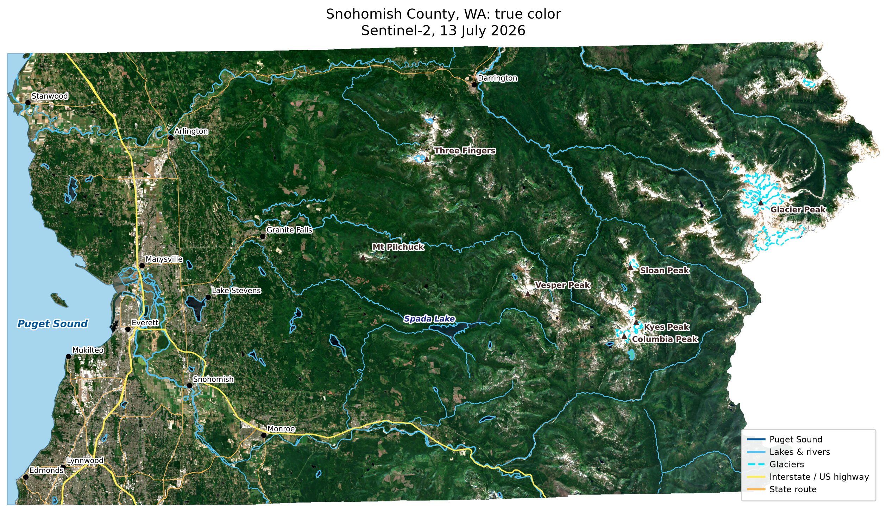
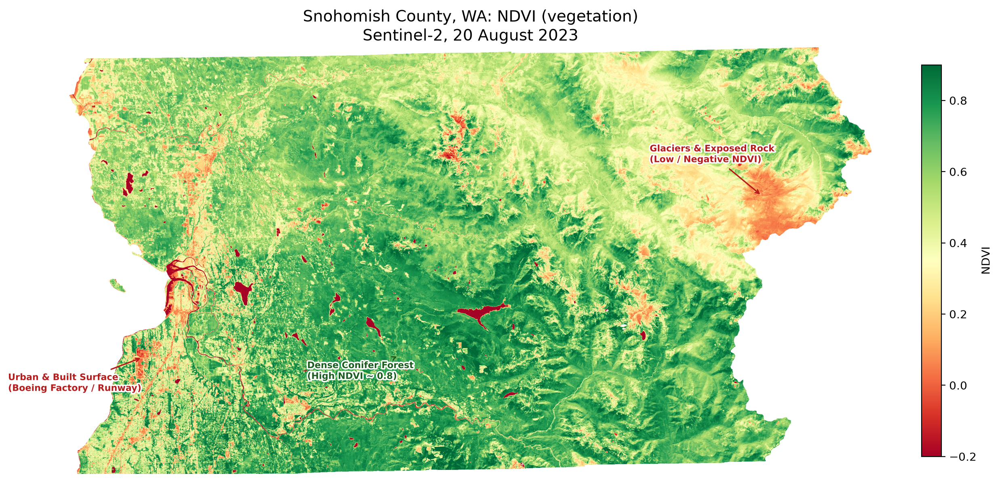

# Seeing Snohomish County from Space

Every few days, satellites pass over nearly every place on Earth and take a picture. The images are free, and anyone with a laptop can download them. Most of us never look.

I have always loved maps. A good map takes a huge, messy piece of the real world and makes it something you can hold in your hands and understand at a glance. It tells you where you are, how things connect, and what is worth a closer look.

This project is my way of exploring all that satellite data. I'm a software engineer, and I wanted to use those skills to learn how raw pixels become a map, picking up geospatial concepts along the way, and to make something beautiful in the process: maps as a kind of art.

### 📊 Project Snapshot
> - **Satellite Data:** Copernicus Sentinel-2 L2A (10 m spatial resolution), mid-July 2026
> - **Spectral Bands:** Band 2 (Blue), Band 3 (Green), Band 4 (Red), Band 8 (NIR)
> - **Vector Data:** US Census Bureau TIGER/Line (County boundary, roads, rivers, lakes)
> - **Target Region:** Snohomish County, WA (~2,100 sq. miles)
> - **Tech Stack:** Python (`rasterio`, `geopandas`, `matplotlib`, `shapely`)
> - **Code:** [github.com/AhutGupta/earth-lens](https://github.com/AhutGupta/earth-lens)

## Why this project

The idea was to start simple, and to start at home. I live in Snohomish County, Washington, which turned out to be a perfect first subject: a huge amount of variety packed into one county, and a place I know well enough to check the results against.

The other ingredient was NDVI, a vegetation index that is simple to calculate and yet known for revealing a lot about a landscape. I wanted to see for myself how much a simple index could show.

## The true-color map

True color is the picture your eyes would see from space: the red, green and blue bands, stretched a little for contrast. If you live here, you can probably find your own neighborhood.

Start at the left edge, in the deep water of **Puget Sound**. Moving east, the shoreline runs past **Mukilteo** and **Edmonds** to the **Port of Everett**, where the **Snohomish River** spreads into its delta. In the north-west are the checkerboard farm fields near **Stanwood** and **Marysville**, and the cities line up along the Interstate 5 corridor, with **Lake Stevens** dark against the streets around it.

Further east the city grid gives way to dark green foothill forest, with **Spada Lake** lying in a long valley. Then the Cascades begin. **Three Fingers**, **Vesper Peak**, **Sloan Peak**, **Kyes Peak** and **Columbia Peak** rise as pale, rocky ridges with July snow still in the gullies. At the far east edge is **Glacier Peak**, a volcano, ringed by glaciers.

Getting the details onto the map was half the fun: drawing Puget Sound as a polygon, adding the roads and rivers as layers, placing peaks and cities by their real coordinates, and nudging the labels so the text doesn't cover what it names.

## The NDVI map

NDVI stands for Normalized Difference Vegetation Index, and it measures how green and healthy the plants in a place are. It works because of how leaves behave. They absorb red light, which they use to make energy, and they bounce back a lot of near-infrared light, which our eyes can't see but the satellite can. Compare the two and you get a number for each pixel:

**NDVI = (NIR − Red) / (NIR + Red)**

The result runs from −1 to +1. Water and snow sit at or below zero, bare ground and pavement are low, and thick, healthy forest is high, closer to 1. On the map, green means plants and red means no plants.

The same satellite pixels that made the true-color map now tell a different story:

- The **glaciers and snowfields** around Glacier Peak and the high ridges glow red.
- **Lakes**, including Spada Lake and Lake Stevens, stand out as red shapes.
- The **river delta** at Everett is a tangle of red and dark water.
- **Cities, roads and the Boeing factory and runway area** near Mukilteo show up in yellow and orange.
- The **farm fields** in the north-west form a patchwork of greens and yellows.

NDVI can't tell *why* a place isn't green. Water, snow, rock and pavement all just read "not plants."

## Where the data comes from

The imagery is from **Sentinel-2**, a family of European Space Agency satellites that are part of the EU's Copernicus program. At 10 meters per pixel, the detail is fine enough to pick out individual roads and lakes. I downloaded the scenes from the Copernicus Browser, choosing ones with little cloud cover. The county boundary, roads, rivers and lakes come from the US Census Bureau.

## How it came together

Four small Python scripts, run in order:

1. **`01_boundary.py`** pulls out the county outline and makes a locator map.
2. **`02_inspect_scenes.py`** checks that the downloaded tiles actually cover the whole county.
3. **`03_mosaic_clip.py`** stitches the tiles into one image, evens out their brightness, and trims it to the county shape.
4. **`04_render.py`** draws the final maps, with the roads, rivers, glaciers, Puget Sound and landmarks on top.

I didn't get it right the first time. My first scene was hazy, so I switched dates. The next one was missing a tile, so I added a second one, taken two days apart, to complete the map.

## What I took away

- **A satellite image is just numbers.** A few lines of code can turn them into a picture you can read or a map of where the plants are.
- **Maps are layers.** Imagery, boundaries, roads and rivers only line up once they share one coordinate system.
- **Redoing teaches more than getting it right once.** Most of what I learned came from the second and third passes.

It also made me appreciate how lucky I am to live somewhere this beautiful, and there is plenty more in this data to explore.

## Hi-Res Maps

Full-resolution (10 m) versions of the maps are available here. Each file is about 100 MB, and clicking a link downloads it.
1. [True Color map](https://github.com/AhutGupta/earth-lens/releases/download/v1.0/true_color.png)
2. [NDVI map](https://github.com/AhutGupta/earth-lens/releases/download/v1.0/ndvi.png)

## Credits

Contains modified Copernicus Sentinel data 2026. County boundaries, roads and water features: US Census Bureau (cb_2023 and TIGER/Line 2023).